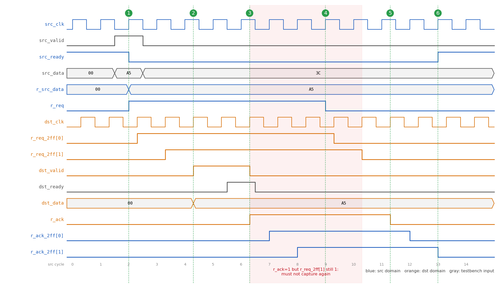

# 半導体フロントエンド設計100本ノック (42) Multi-bit CDC Handshake

半導体フロントエンド設計100本ノック、第42問。

今回は、複数bitのデータを非同期のclock domain間で渡す、4-phaseのreq/ack handshakeを設計してみた。データそのものは同期せずに止めておき、`req`と`ack`の2本だけを2FFで同期する回路である。

最初の版は、2FFのsynchronizerを入れ忘れていた。その後も、同じデータの二重取り込みと、synchronizerの1段目の誤用でつまずいた。最後の1つはtestbenchでは見つからず、RTLを読んで初めて分かった。

課題の詳細は[Day42 Issue](https://github.com/msyksphinz-self/semiconductor-frontend-100knocks/issues/42)。

## 今回の問題：4-phase req/ackでデータを渡す

複数bitのデータを各bitごとに2FFで同期すると、bitごとに到着するcycleがずれ、受信側で壊れた値を観測する。そこで、**データは止めておき、制御信号だけを同期して渡す**。

### 仕様

- `WIDTH >= 1`。デフォルトは`WIDTH=32`。
- source側とdestination側はそれぞれready/valid。`src_clk`と`dst_clk`は互いに非同期で、周波数比は任意。
- 同時に転送中にできるtransactionは1つだけ。
- resetは各domainともactive-lowの非同期reset。両domainのresetは一緒にassertされる前提。
- `req`と`ack`はFFから直接出力し、受信側で2FF synchronizerを通す。synchronizerもresetする。
- データは2FFを通さない。
- `src_ready`は、`req=0`かつ同期後の`ack=0`のときだけ1。
- `dst_valid=1`の間、`dst_data`は保持する。
- 1つのtransactionはちょうど1回だけdestinationへ届く。

```systemverilog
module cdc_handshake #(
    parameter int unsigned WIDTH = 32
) (
    // source domain
    input  logic             src_clk,
    input  logic             src_rst_n,
    input  logic             src_valid,
    output logic             src_ready,
    input  logic [WIDTH-1:0] src_data,

    // destination domain
    input  logic             dst_clk,
    input  logic             dst_rst_n,
    output logic             dst_valid,
    input  logic             dst_ready,
    output logic [WIDTH-1:0] dst_data
);
    // ここにRTLを実装する
endmodule
```

### 4-phaseの手順

| 順 | domain | 条件 | 動作 |
|---:|---|---|---|
| 1 | src | `src_valid && src_ready` | `src_data`を取り込み、`req=1` |
| 2 | dst | 同期後の`req=1`、idle | `r_src_data`を`dst_data`へ取り込み、`dst_valid=1` |
| 3 | dst | `dst_valid && dst_ready` | `dst_valid=0`、`ack=1` |
| 4 | src | 同期後の`ack=1` | `req=0` |
| 5 | dst | 同期後の`req=0` | `ack=0` |
| 6 | src | 同期後の`ack=0` | `src_ready=1`（次を受理できる） |

`req`と`ack`が、1→0まで戻って1往復するので4-phaseと呼ぶ。

## RTL

```systemverilog
logic [WIDTH-1: 0] r_src_data;
logic              r_req;
logic              r_ack;

logic [ 1: 0] r_req_2ff;
logic [ 1: 0] r_ack_2ff;

always_ff @ (posedge src_clk, negedge src_rst_n) begin
  if (!src_rst_n) begin
    r_req <= 1'b0;
    r_ack_2ff <= 2'b00;
  end else begin
    r_ack_2ff <= {r_ack_2ff[0], r_ack};
    if (r_req & r_ack_2ff[1]) begin
      r_req <= 1'b0;
    end else if (src_valid & src_ready) begin
      r_src_data <= src_data;
      r_req      <= 1'b1;
    end
  end
end
assign src_ready = !r_req & !r_ack_2ff[1];

always_ff @ (posedge dst_clk, negedge dst_rst_n) begin
  if (!dst_rst_n) begin
    dst_valid <= 1'b0;
    r_ack     <= 1'b0;
    r_req_2ff <= 2'b00;
  end else begin
    r_req_2ff <= {r_req_2ff[0], r_req};
    if (r_ack & !r_req_2ff[1]) begin
      r_ack <= 1'b0;
    end else if (dst_valid & dst_ready) begin
      dst_valid <= 1'b0;
      r_ack     <= 1'b1;
    end else if (!dst_valid & !r_ack & r_req_2ff[1]) begin
      dst_data  <= r_src_data;
      dst_valid <= 1'b1;
    end
  end
end
```

src側は、dst domainの`r_ack`を`r_ack_2ff`で同期し、2段目の`r_ack_2ff[1]`だけを使う。dst側も同様に、`r_req_2ff[1]`だけを使う。

## 波形で追ってみる

受け渡しの流れが分かりにくいので、上のRTLで1 transactionをシミュレーションし、内部信号を取り出して描いた。2つのclockは同じ周波数で、`dst_clk`のedgeは`src_clk`のedgeの3 ns後にある。

`src_data=8'hA5`を送り、受理の直後に`src_data`を`8'h3C`へ変える。dst側は、`dst_valid`が立ってから1 cycle待って`dst_ready=1`にする。



青はsrc domainのFF、オレンジはdst domainのFF、灰色はtestbenchからの入力である。緑の丸の番号は手順表の番号、下の数字はsrcのcycleである。赤い帯は、後で説明する再取り込みが起きうる区間である。

| cycle | 手順 | 起きていること |
|---:|---:|---|
| 2 | 1 | `src_valid && src_ready`で受理。`r_src_data=A5`、`r_req=1`。直後に`src_data`は`3C`へ変わるが、`r_src_data`は`A5`のまま |
| 2〜3 | | `r_req`が`r_req_2ff[0]`、`r_req_2ff[1]`の順に伝わる |
| 4 | 2 | `r_req_2ff[1]=1`かつidleなので、`dst_data=A5`、`dst_valid=1` |
| 5 | | `dst_ready=1`。cycle 4〜5の間、`dst_data`は保持される |
| 6 | 3 | handshakeが成立し、`dst_valid=0`、`r_ack=1` |
| 7〜8 | | `r_ack`が`r_ack_2ff[0]`、`r_ack_2ff[1]`の順に伝わる |
| 9 | 4 | `r_ack_2ff[1]=1`なので`r_req=0` |
| 11 | 5 | `r_req_2ff[1]=0`なので`r_ack=0` |
| 13 | 6 | `r_ack_2ff[1]=0`なので`src_ready=1` |

波形から、次の3つが読み取れる。

**データが安定している理由**：`r_src_data`はcycle 2で`A5`になり、次に変わるのは`src_ready`が1に戻った後である。dst側が`r_src_data`を読むのはcycle 4で、`r_req`が2FFを通り抜けるのを待った後になる。`r_src_data`と`r_req`は同じedgeで変わるので、`r_req`が2FFを通過する頃には、データの線もとっくに落ち着いている。データ自体を2FFに通す必要がないのはこのためである。

**再取り込みの危険がある区間**：cycle 6〜9は、`r_ack=1`なのに`r_req_2ff[1]`はまだ1である。dst側から見ると「同期後の`req`が1」なので、取り込みの条件が`r_req_2ff[1]`だけだと、ここで同じ`A5`をもう一度取り込んでしまう。取り込みの条件に`!dst_valid & !r_ack`が必要なのはこの区間のためである。

**synchronizerの1段目と2段目**：cycle 7では`r_ack_2ff[0]=1`、`r_ack_2ff[1]=0`である。1段目は相手domainの信号を直接サンプルするFFで、実際の回路ではmetastableになりうる。2段目は、1段目が落ち着くのを1 cycle待った値である。src側の論理は2段目しか見てはいけない。

## 間違えたところ

**2FFのsynchronizerがなかった**：最初の版では、src側がdst domainの`r_ack`を、dst側がsrc domainの`r_req`を直接読んでいた。今回の主題そのものである。

**`src_ready`が`ack`を見ていなかった**：`assign src_ready = !r_req;`だった。波形のcycle 9〜12では`r_req=0`だが、`r_ack_2ff[1]`はまだ1である。ここで次を受理すると、`r_req & r_ack_2ff[1]`が成立して新しい`req`がすぐ消され、そのtransactionが失われる。

**同じデータの再取り込み**：取り込みの条件が`r_req`（2FFを入れた後は`r_req_2ff[1]`）だけだった。上で見たcycle 6〜9の区間で、同じデータが2回届く。2FFを入れる前は、dstのclockがsrcより速いときだけ起きていたが、2FFを入れると`r_req_2ff[1]`が0に戻るのが2 cycle遅れるので、1:1でも起きるようになった。

**synchronizerの1段目を使った**：`src_ready`を直したとき、次のように書いた。

```systemverilog
assign src_ready = !r_req & (r_ack_2ff == 2'b00);
```

`r_ack_2ff == 2'b00`は1段目の`r_ack_2ff[0]`も見ている。動作としては、`ack`が1になり始めたら早めに止めるだけなので、シミュレーションでは区別できず、testbenchは全条件で通った。しかし1段目の不定な値が`src_ready`を通って上流の回路と受理条件に伝わるので、2FFを入れた意味がなくなる。`!r_ack_2ff[1]`に直した。**synchronizerの1段目は、2段目のFFに入れる以外には使わない。**

**ポートの末尾のカンマ**：`output logic [WIDTH-1: 0] dst_data,`のように最後のポートにカンマを付けていた。Verilatorは`NULLPORT`警告で済ませるが、文法エラーにするツールが多い。

## 規模を大きくしたときの考察

**1 transactionにかかる時間**：上の波形では、cycle 2で受理してから、cycle 13で`src_ready`が1に戻るまで11 cycleかかっている。次の受理はcycle 14になるので、同じ周波数でも12 cycleに1回しか送れない（この波形ではdst側が1 cycle待たせている）。2FFを4回通るので、clockの遅い側の周期に支配される。スループットが必要なら、Day43の非同期FIFOを使う。

**2-phase（toggle）との比較**：2-phaseは、`req`と`ack`を「反転したら1回」と数える。往復が1回で済むので、4-phaseのほぼ半分の時間で1 transactionが終わる。代わりに、変化を検出するためのXORと、前の値を覚えるFFが必要になる。4-phaseは毎回0に戻るので、resetの状態と動作中の状態の対応が分かりやすい。

**data pathのCDC制約**：RTLでは「`r_req`が2FFを通る頃にはデータは安定している」と考えたが、実際の回路では`r_src_data`から`dst_data`までの配線遅延がそれより短いことを保証する必要がある。STAでは非同期パスとして除外しつつ、`set_max_delay -datapath_only`などで最大遅延を制約し、bit間のskewも抑える。

**RTLシミュレーションで検証できないこと**：シミュレーションのFFはmetastableにならないので、synchronizerの1段目を誤って使っても今回のように動いてしまう。synchronizerの構成はRTLを読んで確認するか、CDC検証ツールで検査する。

**データ用FFのreset**：`r_src_data`と`dst_data`は、reset付きの`always_ff`の中にresetなしで書いている。この形だと`rst_n`がenableのように付くので、resetしないなら別の`always_ff`に分けた方が素直である。

## 最終RTLについて

RTLは[problems/day42/solution.sv](../problems/day42/solution.sv)、testbenchは[problems/day42/tb.sv](../problems/day42/tb.sv)に置いてある。

## まとめと今後の検証

データは止めておき、制御信号だけを2FFで往復させる。データが安定していることは、`req`が2FFを通り抜ける時間で保証される。受け渡しの後も同期後の`req`はしばらく残るので、取り込みの条件にidleを入れる必要がある。

**Verilatorのlint（`--lint-only -Wall`）はエラーなしで通した。Issueの仕様をもとに別に作成したself-checking testbenchを、`WIDTH=1, 8, 32`、clock比1:1（位相ずれあり）、3:1、1:3、7:5、5:7の各3 seedで実行し、すべて通った。** 確認したのは、clockなしの非同期reset、順序どおりで欠落・重複がないこと、ランダムな`src_valid` / `dst_ready`、`dst_ready=0`を長く続けたときの保持、受理後の`src_data`の変更、連続送信、同期段数の不足の検出である。ただし、RTLシミュレーションの合格はmetastability耐性の証明にはならない。synchronizerの構成はRTLを読んで確認した。
