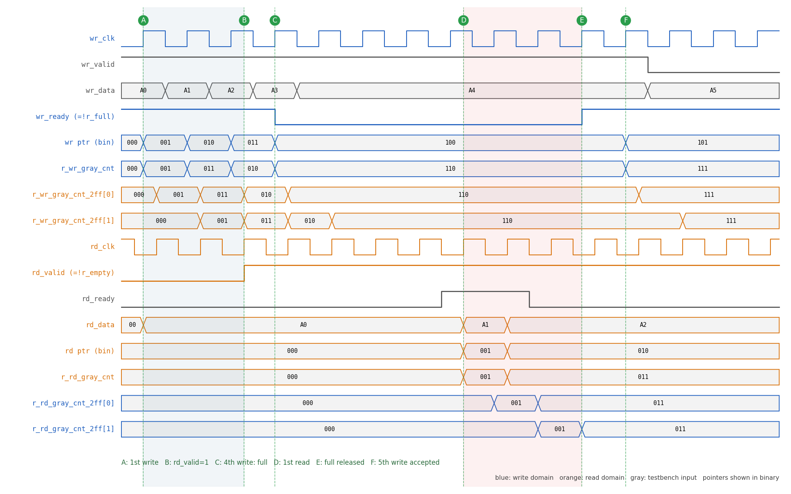

# 半導体フロントエンド設計100本ノック (43) Asynchronous FIFO

半導体フロントエンド設計100本ノック、第43問。

今回は非同期FIFOを設計してみた。書き込み側と読み出し側が別のclockで動き、pointerだけをGray codeで相手のdomainへ渡すFIFOである。Day41のGray codeカウンタと、Day42の2FF synchronizerを組み合わせた問題になる。

構成要素はすでに知っているものばかりだったが、組み上げるとつまずく所が多かった。flagをどのpointerから計算するか、full判定で何bit反転するか、という2点で特に何度も直した。

課題の詳細は[Day43 Issue](https://github.com/msyksphinz-self/semiconductor-frontend-100knocks/issues/43)。

## 今回の問題：pointerをGray codeで渡すFIFO

Day42のhandshakeは、1 transactionごとに`req`と`ack`の往復が必要でスループットが低い。非同期FIFOは、書き込み側と読み出し側がそれぞれのclockで動き、**pointerだけをGray codeで相手のdomainへ渡す**ことで、連続転送を可能にする。

判定には相手の**少し古いpointer**しか使えない。それでも誤ってoverflow / underflowしないように、full / emptyを保守的に判定することが主題である。

### 仕様

- `WIDTH >= 1`。デフォルトは`WIDTH=32`、`DEPTH=16`。`DEPTH`は2のべき乗かつ`DEPTH >= 4`。
- 書き込み側、読み出し側はそれぞれready/valid。`wr_clk`と`rd_clk`は互いに非同期で、周波数比は任意。
- pointerは`$clog2(DEPTH)+1` bit。下位bitがmemoryのindex、追加のMSBが周回の区別に使われる。
- pointerはGray codeのFF出力を、相手domainの2FF synchronizerで受ける。
- fullは書き込み側で、emptyは読み出し側で判定する。
- `wr_ready = !r_full`、`rd_valid = !r_empty`。`r_full`と`r_empty`はFFとし、次のpointerから計算する。
- `r_full`の次の値は、`wr_gray_next`が、同期後の読み出しpointerの上位2 bitを反転した値と一致すること。
- `r_empty`の次の値は、`rd_gray_next`が、同期後の書き込みpointerと一致すること。
- `rd_data`は、読み出しpointerの指すentryを組合せで出力する（first-word fall-through）。
- memoryはFF配列でresetしない。
- resetは各domainともactive-lowの非同期reset。reset後は`r_full=0`、`r_empty=1`。

```systemverilog
module async_fifo #(
    parameter int unsigned WIDTH = 32,
    parameter int unsigned DEPTH = 16
) (
    // write domain
    input  logic             wr_clk,
    input  logic             wr_rst_n,
    input  logic             wr_valid,
    output logic             wr_ready,
    input  logic [WIDTH-1:0] wr_data,

    // read domain
    input  logic             rd_clk,
    input  logic             rd_rst_n,
    output logic             rd_valid,
    input  logic             rd_ready,
    output logic [WIDTH-1:0] rd_data
);
    // ここにRTLを実装する
endmodule
```

## なぜpointerをGray codeで渡すのか

最初に疑問に思ったのは、clockをまたぐpointerは本当にGray codeでなければいけないのか、ということだった。

受信側の2FFは、送信側のpointerが変化している最中にサンプルすることがある。そのとき、変化中のbitはそれぞれ独立に、古い値か新しい値のどちらかに落ち着く。

`DEPTH=4`（pointer 3 bit）で、読み出しpointerが`011`、書き込みpointerが`011`から`100`へ進む場合（1個書いた）を考える。

| 書き込みpointer | 変化するbit | 読み出し側に見えうる値 |
|---|---|---|
| binary `011 → 100` | 3 bit全部 | `000`〜`111`のどれでも |
| Gray `010 → 110` | bit2だけ | `010`（古い値）か`110`（新しい値） |

binaryで`111`に見えると、読み出し側は「4個入っている」と判断し、まだ書かれていないentryを読んでしまう。

Gray codeなら、見える値は古い値か新しい値のどちらかである。新しい値なら正しく、古い値なら少し遅れて見えるだけになる。pointerは1 cycleに最大1しか進まないので、どの瞬間にも変化中のbitは1つだけ、という点が効いている（Day41で考えた性質）。

memoryのindexに使うのはbinaryのままでよい。clockをまたぐ値だけをGray codeにする。

## full判定で上位2 bitを反転する理由

binary pointerなら、fullは「MSBだけ違い、残りが一致」である。書き込みpointerが読み出しpointerのちょうど`DEPTH`個先にいる状態だ。

ところがGray codeでは、`DEPTH`個先の値は**上位2 bit**が反転し、残りが一致する。

| 読み出しptr（bin / gray） | 4個先の書き込みptr（bin / gray） |
|---|---|
| `000 / 000` | `100 / 110` |
| `001 / 001` | `101 / 111` |
| `011 / 010` | `111 / 100` |

Gray codeの各bitは、binaryの隣り合う2 bitのXORである。binaryでMSBが反転すると、Gray codeではMSBと、その1つ下のbit（MSBとのXORを含む）の2つが反転する。それより下のbitは、binaryの値が同じなので変わらない。

最初はbinaryの感覚のまま、MSBの1 bitだけを反転して比べていた。この式だと、本当はfullの`000`と`110`を「fullでない」と判定し、1個しか入っていない`010`と`110`を「full」と判定してしまう。

## なぜflagをFFにするのか

もう1つの疑問は、`r_full`と`r_empty`がなぜFFでなければいけないのか、だった。

実は、正しく動かすだけなら組合せでもよい。現在のpointerと、同期後の相手pointerを比べて組合せで出しても、相手のpointerが古いぶん判定は保守的になるだけで、overflowもunderflowも起きない。

FFにする理由は主にタイミングである。

- `wr_ready` / `rd_valid`はFIFOの外の回路に入る。組合せだと、synchronizerの出力から多bitの比較器を通った信号が、そのまま上流・下流の論理につながる。
- `wr_ready`は`wr_valid & wr_ready`を通ってpointerを進める条件にもなる。組合せだと「比較器 → enable → 加算器 → Gray変換 → FF」が1本のパスになる。

FFにすると解除が1 cycle遅れるが、もともと2FFで2〜3 cycle遅れているので、影響は小さい。

ただし、**FFにするなら次のpointerから計算しなければならない**。現在のpointerで計算すると、最後の1個を書いたedgeで`r_full`が1にならず、次のcycleにもう1個受理してoverflowする。読み出し側も同様にunderflowする。今回これで2回つまずいた。

## RTL

```systemverilog
always_comb begin
  w_wr_bin_cnt_next = r_wr_bin_cnt;
  if (wr_valid & wr_ready) begin
    w_wr_bin_cnt_next = r_wr_bin_cnt + 'h1;
  end
  w_wr_gray_cnt_next = w_wr_bin_cnt_next ^ (w_wr_bin_cnt_next >> 1);
end

always_ff @ (posedge wr_clk, negedge wr_rst_n) begin
  if (!wr_rst_n) begin
    r_wr_bin_cnt         <= 'h0;
    r_wr_gray_cnt        <= 'h0;

    r_rd_gray_cnt_2ff[0] <= 'h0;
    r_rd_gray_cnt_2ff[1] <= 'h0;

    r_full               <= 1'b0;
  end else begin
    r_rd_gray_cnt_2ff[0] <= r_rd_gray_cnt;
    r_rd_gray_cnt_2ff[1] <= r_rd_gray_cnt_2ff[0];

    r_wr_bin_cnt         <= w_wr_bin_cnt_next;
    r_wr_gray_cnt        <= w_wr_gray_cnt_next;

    r_full <= (w_wr_gray_cnt_next[$clog2(DEPTH) -: 2] == ~r_rd_gray_cnt_2ff[1][$clog2(DEPTH) -: 2]) &
              (w_wr_gray_cnt_next[$clog2(DEPTH)-2: 0] ==  r_rd_gray_cnt_2ff[1][$clog2(DEPTH)-2: 0]);
  end
end

always_ff @ (posedge wr_clk) begin
  if (wr_valid & wr_ready) begin
    r_fifo[r_wr_bin_cnt[$clog2(DEPTH)-1: 0]] <= wr_data;
  end
end

assign wr_ready = !r_full;
```

読み出し側も同じ形で、`r_empty`は`w_rd_gray_cnt_next == r_wr_gray_cnt_2ff[1]`で更新し、reset値を1にする。`rd_data`は`r_fifo[r_rd_bin_cnt[$clog2(DEPTH)-1: 0]]`を組合せで出す。

各domainで、次のbinary pointerとそのGray codeを組合せで作り、pointerのFFとflagのFFを同じedgeで更新する。Day41の`gray_counter`と同じ構成である。

## 波形で追ってみる

`DEPTH=4`で、読み出しを止めたまま5個書こうとし、途中で2個読み出す。2つのclockは同じ周波数で、`rd_clk`のedgeは`wr_clk`のedgeの3 ns後にある。上のRTLをシミュレーションし、信号を1 nsごとにサンプルして描いた。pointerはbinary表記である。



青は書き込みdomainのFF、オレンジは読み出しdomainのFF、灰色はtestbenchからの入力である。

| 印 | 起きていること |
|---|---|
| A | 1個目（`A0`）を書く。書き込みのGray pointerが`001`になる |
| B | Gray pointerが読み出し側の2FFを通り、`r_empty`が0になって`rd_valid=1`。Aから3 cycle遅れる（青い帯） |
| C | 4個目（`A3`）を書いたedgeで、次のpointer`100`（Gray`110`）と読み出しpointer`000`を比べて`r_full=1`。同じedgeでfullになるので、5個目（`A4`）は受理されない |
| D | 1個目を読む。読み出しのGray pointerが`001`になる |
| E | そのpointerが書き込み側の2FFを通り、`r_full=0`。Dから3 cycle遅れる（赤い帯） |
| F | 待たされていた5個目（`A4`）を受理する |

波形から次の2つが読み取れる。

**遅れは安全側にしか働かない**：赤い帯の間、FIFOには実際には空きが1つあるのに、書き込み側は古い読み出しpointerを見ているので`wr_ready=0`のままである。青い帯の間も、データはあるのに`rd_valid=0`である。どちらも「待たされる」方向の誤りで、壊れる方向の誤りにはならない。

**次のpointerから計算する意味**：Cでは、4個目を書いたedgeで`r_full`が1になっている。もし現在のpointer（まだ`011`）で計算していたら、`r_full`が1になるのは1 cycle後で、その間に`A4`を受理して`A0`を上書きしてしまう。

## 間違えたところ

量が多かったので、まとめて並べる。

**ポートの向き**：`rd_valid`をinput、`rd_ready`をoutputにしていた。

**fullの判定が逆**：「fullである」条件を計算して、そのまま`wr_ready`に入れていた。後でFFにしたときにも、`!`を付けたまま`r_full`に移して、もう一度逆になった。

**full判定が1 bit**：上で書いたとおり、Gray codeでは上位2 bitを反転する必要がある。

**memoryのindexが1 bit多い**：`r_fifo[r_wr_bin_cnt]`と、周回bitを含むpointerでindexしていた。後半の周で範囲外を指す。lintの`WIDTHTRUNC`警告で分かる。

**Gray pointerが組合せ出力**：binaryから`assign`でXORした値を、そのまま相手側の2FFに入れていた。複数bitが変わるcycleでXORの出力にglitchが出て、それをサンプルされると、1 bitしか変わらないという前提が崩れる。

**synchronizerと`r_wr_gray_cnt`のresetがない**：reset直後に相手側が不定のpointerを受け取り、full / emptyが不定になる。

**flagが組合せ、その後は現在のpointerで計算**：上で書いたとおり。

**同期reset**：`always_ff @ (posedge wr_clk)`だけで書いていた。仕様は非同期reset。

**`r_empty`のreset値**：0にしていた。reset中に`rd_valid=1`になる。

**blocking代入**：Gray pointerのFFで`=`を使い、reset側の`<=`と混ざってlintがエラーになった。

**ポートの末尾のカンマ**：Day42と同じ。

## 規模を大きくしたときの考察

**`DEPTH`が2のべき乗でない場合**：pointerを`0〜DEPTH-1`で回すと、wrapのところでGray codeが複数bit変わる。例えば`0〜5`なら、`gray(5)=111`から`gray(0)=000`で3 bit同時に変わり、Gray codeで渡す意味がなくなる。また、full判定の「上位2 bitを反転」も成り立たない。

**実効スループットと必要なdepth**：fullとemptyの解除は、相手側の2FFとflagのFFを通るので3 cycleほど遅れる。上の波形でも、空きができてから書けるまでに3 cycleかかっている。連続で流すには、この往復の遅れの間に書き込み側が書く個数より大きいdepthが必要になる。clockが遅い側の周期で数えた遅れに、clock比を掛けて見積もる。

**データのパス**：`rd_data`は書き込みdomainのFF（memory）から、読み出しdomainへ同期なしで出ている。読み出し側がそのentryを読むのは、書き込みpointerが2FFを通った後なので、memoryの値はとっくに安定している。Day42でデータを2FFに通さなかったのと同じ理屈である。

**CDC制約**：Gray pointerは「1 bitしか変わらない」ことが前提なので、配線遅延のばらつきで、複数のbitが別々のcycleに到着してはいけない。Gray pointerの各bitについて、書き込み側のFFから相手側の1段目のFFまでの遅延とskewを、受信側のclock周期以内に収める制約（`set_max_delay -datapath_only`やbus skewの制約）が必要になる。

**RTLシミュレーションで検証できないこと**：シミュレーションでは、変化中のbitがばらばらに落ち着く現象は起きない。binary pointerをそのまま同期しても、synchronizerの1段目を使っても、シミュレーションは通ってしまう。

## 最終RTLについて

RTLは[problems/day43/solution.sv](../problems/day43/solution.sv)、testbenchは[problems/day43/tb.sv](../problems/day43/tb.sv)に置いてある。

## まとめと今後の検証

非同期FIFOは、Gray codeのpointerを2FFで相手に渡し、少し古いpointerで保守的にfull / emptyを判定する。遅れは「待たされる」方向にしか働かない。flagをFFにするなら次のpointerから計算し、Gray codeのfull判定では上位2 bitを反転する。

**Verilatorのlint（`--lint-only -Wall`）はエラーなしで通した。Issueの仕様をもとに別に作成したself-checking testbenchを、`DEPTH=4, 8, 16`（`WIDTH=32`）と`WIDTH=1`（`DEPTH=8`）、clock比1:1（位相ずれあり）、3:1、1:3、7:5、5:7の各3 seed、計60通りで実行し、すべて通った。** 確認したのは、clockなしの非同期reset、順序どおりで欠落・重複がないこと、`DEPTH`個まで書けて`DEPTH+1`個目が受理されないこと、全部読むと`rd_valid=0`になること、pointerが何周もする連続転送、ランダムな`wr_valid` / `rd_ready`、`rd_valid=1`の間の`rd_data`の保持、そして各edgeで相手側に届いているはずのpointerだけでfull / emptyを判定しているかである。ただし、RTLシミュレーションの合格はmetastability耐性の証明にはならない。Gray codeで渡していること、synchronizerの2段目だけを使っていることは、RTLを読んで確認した。
